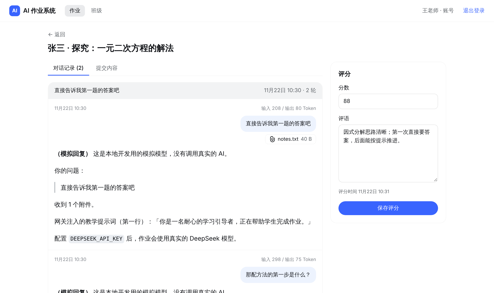

# AI Homework System

老师布置作业，学生在作业期间使用系统内置的 AI 完成作业。系统记录学生使用 AI 的全过程（提问、上传的文件、AI 的回答），老师据此查看过程、评估作业。

- 设计文档：[docs/design.md](docs/design.md)
- 前端基于 [deepseek-ai/chat-demo](https://github.com/deepseek-ai/chat-demo)（MIT）改写

| 学生：作业聊天 | 老师：完成情况 | 老师：对话回放 |
| --- | --- | --- |
|  |  |  |

## 功能（第一期）

**老师**
- 创建班级，批量创建学生账号（初始密码只显示一次，可下载 CSV），重置密码
- 布置作业：开始/截止时间、作业要求（Markdown）、草稿/发布、是否允许迟交
- 按作业配置 AI：模型、教学模式（引导式 / 讲解式 / 开放式 / 自定义提示词）、联网搜索、文件上传、深度思考、每个学生的 Token 额度
- 试用 AI：用学生看到的界面预览作业配置
- 完成情况：每个学生的提问数、Token、活跃天数、最近使用、提交状态
- 学生详情：按时间回放全部对话（包括重新生成、编辑重发、中途停止的记录），查看附件、提交内容，打分和写评语，导出 CSV

**学生**
- 作业列表（进行中 / 未开始 / 已截止，剩余时间，提交状态）
- 作业聊天：chat-demo 原有的体验（流式回答、深度思考、Markdown、公式、代码、上传文件），顶部显示作业要求、截止时间和「对话会被老师查看」的提示
- 提交作业：文字 + 附件 + 诚信声明，截止前可以修改

**后端网关**
- 学生的浏览器只和我们的后端通信，拿不到模型的 API Key
- 每次请求都按作业配置改写：老师的教学提示词放在系统提示词最前面，学生无法覆盖；按开关去掉联网搜索、深度思考；检查时间窗口和额度
- 原样流式转发给浏览器，同时把本轮问题、完整回答、用量、耗时存档；上传的文件保留原件

## 本地运行

需要 Node.js 22.12+ 和 pnpm 10。

```bash
pnpm install
```

```bash
pnpm seed
```

```bash
pnpm dev
```

打开 http://localhost:8090 ，用演示账号登录（密码都是 `demo1234`）：

| 账号 | 角色 |
| --- | --- |
| `teacher` | 老师（王老师，「试点班」） |
| `student1` / `student2` / `student3` | 学生 |

没有配置 `DEEPSEEK_API_KEY` 时，作业使用**模拟模型**：不调用任何外部服务，回复里会显示网关注入的教学提示词，方便检查配置。配置 Key 后就能在作业里选 DeepSeek 模型：

```bash
cp .env.example .env
```

数据默认存在 `.data/`（PGlite 数据库和上传的文件），删掉这个目录就能重置。

## 部署

```bash
pnpm build
```

```bash
pnpm start
```

后端在 `PORT`（默认 8787）上同时提供接口和前端页面。上线前：

1. 用 HTTPS（例如放在 Caddy 或平台自带的 HTTPS 后面），并设置 `COOKIE_SECURE=true`（`NODE_ENV=production` 时默认开启）。
2. 创建老师账号：

   ```bash
   pnpm --filter @hw/server create-teacher --username wang --name 王老师
   ```

3. 数据库：默认 PGlite 存在 `DATA_DIR`；也可以设置 `DATABASE_URL` 使用 Neon / Supabase / 自建 Postgres，启动时自动建表。
4. 上传的文件存在 `DATA_DIR/uploads`，需要持久磁盘。部署到磁盘不持久的平台前，需要先实现 S3 兼容存储（见设计文档第 8 节）。

环境变量见 [.env.example](.env.example)。

## 开发

```bash
pnpm test
```

```bash
pnpm type
```

```
apps/
  web/              # chat-demo（git subtree）+ src/platform/ 下的作业系统页面
  server/           # Hono + Drizzle：REST API、AI 网关、测试
packages/shared/    # 前后端共享的类型和常量
docs/design.md      # 设计文档
```

修改数据库表结构后生成迁移：

```bash
pnpm --filter @hw/server db:generate
```

合并 chat-demo 上游更新：

```bash
git subtree pull --prefix apps/web https://github.com/deepseek-ai/chat-demo.git main --squash
```
